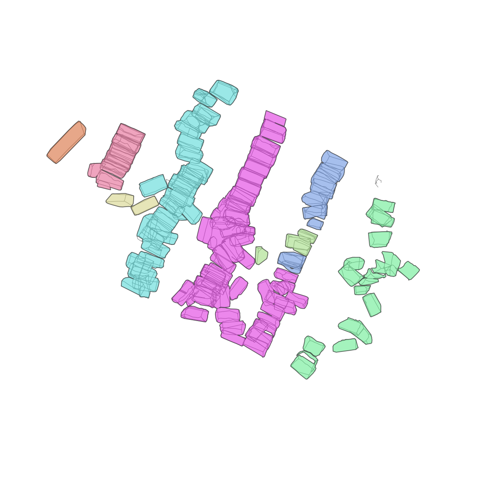
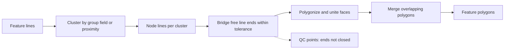
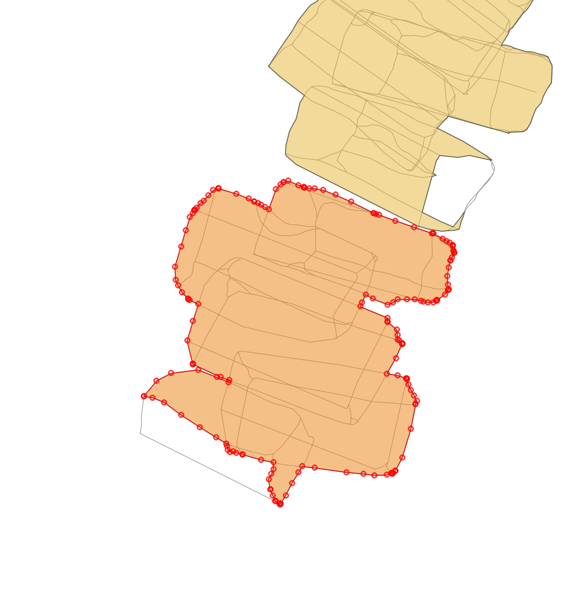

# Featurelines to Polygons

A QGIS Processing script that turns the outlines of archaeological features, drawn as a mix of **open and closed lines**, into **polygons covering the full extent of each feature**. Attribute values and vertex Z values are carried over, like in the native *Lines to polygons* tool.

*Input: feature lines of an excavated stone setting – many closed and open lines whose ends do not meet exactly.*

*Result: one polygon per stone/feature outline (coloured by an attribute of the layer). Lines that form no outline, such as the small open line at the upper right, produce no polygon.*

## Why not the convex hull?

A convex hull wraps every outlier and ignores concave outlines. *Lines to polygons* only works on perfectly noded, closed rings. Real excavation drawings contain neither. This script closes the outline of a feature from whatever lines are there:

- **Only line ends are bridged**, never parallel lines. Free areas inside a feature stay free, even if their opening is narrow.
- Gaps and mismatching start/end vertices of open lines are closed within a **gap tolerance** you choose.
- Lines are grouped to features by a **group field** (e.g. feature number) or, without one, by proximity.
- Overlapping result polygons can be **merged** in the same run.
- Line ends that could not be closed can be written to a **QC point layer**, so you know exactly where to fix the drawing.
- All settings are **remembered in the QGIS project**.

## Requirements

- QGIS 3.x or 4.x. Developed and tested with **QGIS 4.2.2** (Qt 6, GEOS 3.14).
- The *Concave hull* fallback needs QGIS ≥ 3.28. Everything else uses long-standing PyQGIS functions.
- No extra Python packages.

## Installation

1. Download `Featurelines-to-polygons.py` from the [latest release](../../releases/latest).
2. In QGIS open **Processing Toolbox → Scripts (Python icon) → Add Script to Toolbox…** and select the file.
   Alternatively copy it into `processing/scripts` of your profile (*Settings → User Profiles → Open Active Profile Folder*).
3. The tool appears under **Scripts → Archaeology → Featurelines to Polygons**.

## Quick start

1. Open the tool and choose your **line layer** (a selection is respected if *Selected features only* is ticked).
2. Optional: choose a **group field** containing the feature number.
3. Set the **gap tolerance** in layer units (start with `0.05` for a metric CRS).
4. Tick **Unclosed line ends (QC points)** if you want the diagnostic layer.
5. Run. Check the QC points, adjust the tolerance if needed, run again.

## Parameters

| Parameter | Meaning | Default |
|---|---|---|
| Feature lines | Input line layer (open and closed lines, Z optional) | last used |
| Group field | Lines with the same value form one feature. Empty values fall back to proximity clustering | none |
| Gap tolerance | Maximum distance over which a free line end is connected to another line end or line. Also the distance below which lines count as one feature when no group field is set | 0.05 |
| Fallback | What to do with clusters without any closed outline: *Skip*, *Concave hull*, *Convex hull* | Skip |
| Concavity | Only for *Concave hull*: 1 = convex hull, 0 = tightest concave hull | 0.3 |
| Merge overlapping result polygons | Unites polygons that overlap by area | on |
| Minimum area | Result polygons smaller than this are discarded | 0 |
| Unclosed line ends (QC points) | Optional point layer with every free end that could not be closed | off |

## How it works

Attributes are copied from the **longest line of each cluster**; no fields are added. For merged polygons the attributes of the largest polygon are used.

## Troubleshooting in a nutshell

*Result for one feature. The line at the lower left is not connected to the rest of the outline, so the area behind it is missing. The QC layer marks such an end; raising the tolerance or snapping the end closes the outline.*

| Symptom | Cause and remedy |
|---|---|
| A small area next to a clear outline line is missing | The outline is not closed: a line end is further away than the tolerance. Check the QC points, raise the tolerance or snap the end |
| Neighbouring features are merged | Tolerance larger than the distance between features. Lower it or use a group field |
| A free area inside the feature is filled | It is completely enclosed by lines and cannot be told apart from a stone (see limitations) |
| A cluster gives no polygon | No closed outline within tolerance. Use a fallback or fix the lines |

More in the [user manual](docs/USER_MANUAL.md).

## Limitations

- A free area that is **completely enclosed** by lines is filled, because topologically it is a closed face like any other.
- Gaps larger than the tolerance stay open (use the fallback or fix the drawing).
- Curved segments are converted to straight segments.

## Documentation

- [User manual](docs/USER_MANUAL.md)
- [Release notes](RELEASE_NOTES.md)

## License and author

Released under the [MIT License](LICENSE).
Author: **L453RP0MM35**
