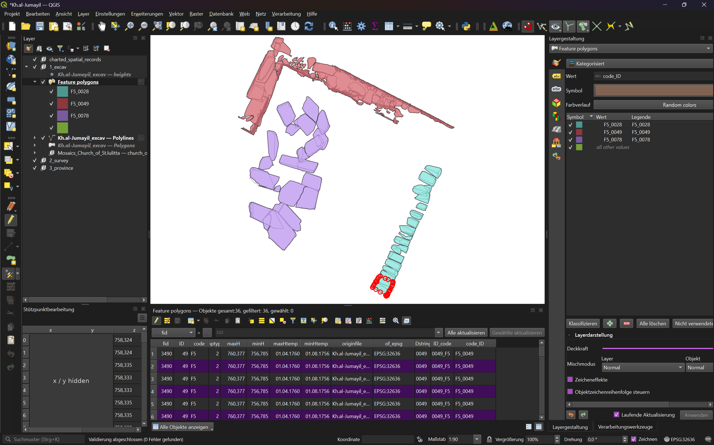
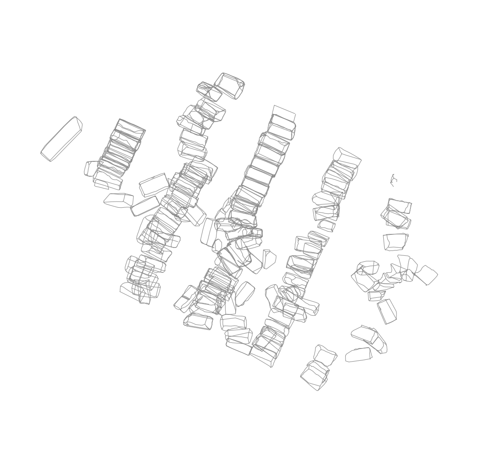
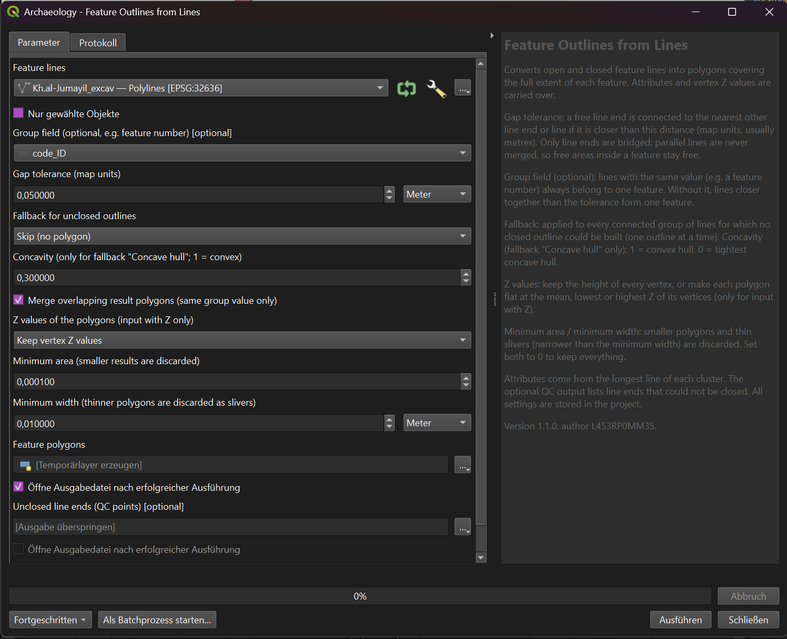

# Feature Outlines from Lines

**Draw your features as lines in the field, get finished polygons in QGIS.**

On excavations, stones, walls and other features are usually measured as lines – some closed, many left open, ends that do not quite meet. This QGIS tool turns those lines into one polygon per feature, **keeps the heights (Z) and copies all attribute values**, and does the closing of gaps for you, so you no longer have to redraw outlines by hand.

*A wall made almost entirely of open lines, converted to polygons. Bottom left: the vertex editor shows the heights taken over from the lines. Bottom: the attribute table shows the attribute values copied 1:1. The result is only as good as the measurement in the field allows.*

## What you get

- **One polygon per feature outline**, even if the outline was measured with open lines that do not touch exactly.
- **Free areas stay free.** The tool closes gaps at line ends only. It does not glue neighbouring lines together.
- **Your data is carried over:** attribute values are copied unchanged, and heights are kept (or made flat – your choice).
- **Nothing is hidden:** an optional point layer shows every line end that could not be closed, so you know where to fix the drawing.

  
  

*Left: the lines. Right: the polygons, coloured by an attribute.*

## Before you start

- QGIS 3.x or 4.x (developed and tested with QGIS 4.2.2). The *Concave hull* option needs QGIS 3.28 or newer.
- A **line layer** with your feature lines, in a **metric coordinate system** (distances are entered in metres).
- Recommended: a **field with the feature number** (for example `code_ID`). It tells the tool which lines belong together.

## Install

1. Download `Feature-Outlines-from-Lines.py` from the [latest release](../../releases/latest).
2. In QGIS open **Processing Toolbox → Scripts (Python icon) → Add Script to Toolbox…** and select the file.
3. You now find the tool under **Scripts → Archaeology → Feature Outlines from Lines**.

## Use it

1. Open the tool and choose your **line layer**. To process only some features, select them and tick *Selected features only*.
2. Choose the **group field** with the feature number (or leave it empty).
3. Leave the **gap tolerance** at `0.05` (5 cm) to start with.
4. Create the **Unclosed line ends (QC points)** layer if you want to see where outlines stay open.
5. Click **Run**. The settings are remembered in your QGIS project (save the project to keep them).

*The dialog with the defaults.*

If an area is missing, look at the QC points: an outline is open there. Raise the tolerance a little (for example `0.1`) or connect the line ends, and run again.

## The settings that matter

| Setting | What it does | Start with |
|---|---|---|
| **Gap tolerance** | How far apart two line ends may be and still be joined. Larger than your biggest gap, but smaller than the distance between features | `0.05` |
| **Group field** | Lines with the same value belong to one feature, however far apart they are. Without it, lines closer than the tolerance are one feature | feature number |
| **Z values** | *Keep vertex Z values*, or make each polygon **flat** at the **mean**, **lowest** or **highest** height of its vertices | keep vertex Z |
| **Fallback** | What to do with an outline that cannot be closed: nothing, or wrap it with a *concave* or *convex hull* | skip |

Less often needed: *Merge overlapping polygons* (only polygons with the same group value are merged), *Minimum area* and *Minimum width* (remove tiny and very thin leftovers; defaults `0.0001` and `0.01`), *Concavity* (for the concave hull). All of them are explained in the [user manual](docs/USER_MANUAL.md).

## How it works, in short

1. Lines of the same feature are collected, by the group field or by distance.
2. Line ends that are close to another line end or line are connected.
3. Every area enclosed by lines becomes a polygon.
4. Tiny and very thin leftovers are removed, overlapping polygons of the same feature are merged.

Attributes are taken from the longest line of a feature. Heights are the vertex heights of your lines.

## If something looks wrong

*The line at the lower left is not connected to the rest of the outline, so the area behind it is missing. The QC layer marks such a line end.*

| What you see | What to do |
|---|---|
| An area next to a clear outline line is missing | The outline is not closed. Check the QC points, raise the gap tolerance or connect the line end |
| Small stones are missing | They are smaller than *Minimum area* or *Minimum width*. Lower both |
| Small triangles appear | Keep *Minimum area* and *Minimum width* at their defaults |
| Two neighbouring features are joined | Gap tolerance is bigger than the distance between them. Lower it or use a group field |
| A free area inside a feature is filled | It is completely enclosed by lines, so it cannot be told apart from a stone |

## Good to know

- A free area that is **completely enclosed** by lines is filled.
- Gaps larger than the tolerance stay open. Use the fallback or close them in the drawing.
- Curved line segments are converted to straight ones.

## More

- [User manual](docs/USER_MANUAL.md) – every setting in detail, tips for finding the right tolerance
- [Release notes](RELEASE_NOTES.md)

## License and author

Released under the [MIT License](LICENSE). Author: **L453RP0MM35**
