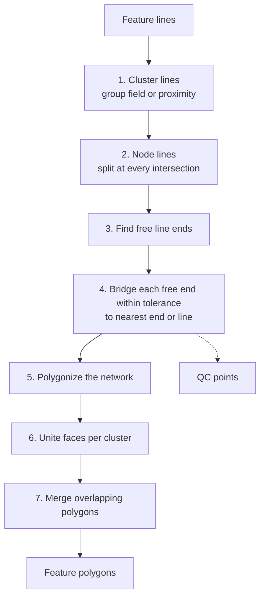

# Featurelines to Polygons – User manual

Version 1.0.0 · Author: L453RP0MM35

## Contents

1. [Purpose](#1-purpose)
2. [Installation](#2-installation)
3. [Preparing your data](#3-preparing-your-data)
4. [Running the tool step by step](#4-running-the-tool-step-by-step)
5. [Parameters in detail](#5-parameters-in-detail)
6. [Outputs](#6-outputs)
7. [How the tool works](#7-how-the-tool-works)
8. [Finding the right tolerance](#8-finding-the-right-tolerance)
9. [Group field or proximity?](#9-group-field-or-proximity)
10. [Fallback and concavity](#10-fallback-and-concavity)
11. [Stored settings](#11-stored-settings)
12. [Troubleshooting](#12-troubleshooting)
13. [Limitations](#13-limitations)

---

## 1. Purpose

Archaeological features (walls, stone settings, pits, …) are usually drawn as many **closed and open lines**: stone outlines, cut lines, auxiliary lines. For further work you need **one polygon per feature** that covers its largest extent, with the attributes and heights of the lines.

QGIS offers two tools for this, and neither fits well:

- *Lines to polygons* needs perfectly closed, noded rings.
- *Convex hull* ignores concave outlines and includes everything in between.

*Featurelines to Polygons* builds the outline from the lines that are actually there and tolerates small gaps and line ends that do not meet exactly.

*Input: lines of an excavated stone setting.*

*Result: the extent of each feature as a polygon (coloured by an attribute of the layer). Lines that form no outline, such as the small open line at the upper right, produce no polygon.*

## 2. Installation

1. Download `Featurelines-to-polygons.py` from the release page.
2. In QGIS: **Processing Toolbox → Scripts (Python icon) → Add Script to Toolbox…**, select the file.
   Or copy it to `processing/scripts` in your profile folder (*Settings → User Profiles → Open Active Profile Folder*).
3. Find it under **Scripts → Archaeology → Featurelines to Polygons** (or search for "featurelines" in the toolbox).

If the tool does not show up, open *Processing → Options → Scripts*, check the script folder, and look at the Processing log for a Python error message. If everything fails, renaming the file with underscores instead of hyphens is a safe fallback.

## 3. Preparing your data

- **Line layer:** any layer with line geometries. Open and closed lines can be mixed freely; multi-part lines and curves are accepted. Z values are optional.
- **Projected CRS in metres** is recommended. All distances (tolerance, minimum area) are in the units of the layer CRS.
- **Group field (optional):** a field with the feature number or code (for example `code_ID`). It makes the result much more reliable when features lie close together.
- **Selection:** if you only want to process some features, select them and tick *Selected features only* next to the input layer. A layer filter works as well.

## 4. Running the tool step by step

1. Open **Featurelines to Polygons**.
2. **Feature lines:** pick the layer.
3. **Group field:** pick the feature number field, or leave it empty.
4. **Gap tolerance:** enter a value in layer units, e.g. `0.05`.
5. Leave **Fallback** on *Skip* for the first run.
6. Keep **Merge overlapping result polygons** ticked.
7. Under *Unclosed line ends (QC points)* choose *Create temporary layer*.
8. Click **Run**.
9. Look at the result and at the QC points. Where an outline is still missing, increase the tolerance or fix the line, then run again.

The Processing log reports how many lines were read, how many clusters were formed, how many line ends could not be closed, how many polygons were written, and which clusters produced no polygon.

## 5. Parameters in detail

| Parameter | Description |
|---|---|
| **Feature lines** | Input layer. |
| **Group field** | Lines with the same value are always treated as one feature, no matter how far apart they are. Lines with an empty value are grouped by proximity instead. |
| **Gap tolerance** | The central parameter. A *free line end* is connected to the nearest other free line end, or otherwise to the nearest point on another line, if it is closer than this value. Without a group field it is also the distance below which lines are considered to belong to the same feature. |
| **Fallback** | Applies only to clusters in which not a single closed outline could be built. *Skip* produces no polygon for them (they are listed in the log). *Concave hull* and *Convex hull* wrap the lines instead. |
| **Concavity** | Only for the fallback *Concave hull*. 1 gives the convex hull, 0 the tightest possible concave hull. Try values between 0.1 and 0.5. |
| **Merge overlapping result polygons** | Polygons from different clusters that overlap by area are united into one. Polygons that merely touch are not merged across clusters. Within one cluster all faces are always united. |
| **Minimum area** | Result polygons with a smaller area are discarded. Use `0` to keep everything. Note that this also removes small, isolated parts. |
| **Unclosed line ends (QC points)** | Optional point layer with every free end that could not be connected within the tolerance. |

## 6. Outputs

### Feature polygons

- Geometry: Polygon, or PolygonZ if the input layer has Z values.
- Fields: **the same fields as the input layer** – no fields are added.
- Attribute values come from the **longest line of each cluster**. For merged polygons they come from the largest polygon.
- The Z values of the input vertices are preserved. Polygons created by a hull fallback get the mean Z of their lines.

### QC points (optional)

One point per free line end that could not be closed. Not every point is an error: a genuinely open line, such as an auxiliary or cut line that is not part of an outline, shows up here as well. Use the points to check the places where an outline is missing.

*A line at the lower left is not connected to the outline, so the area behind it is missing from the polygon. This is exactly the kind of place the QC layer points to.*

## 7. How the tool works

1. **Cluster.** Lines with the same group value form a cluster. Lines without a value are buffered by half the tolerance; lines whose buffers touch are closer than the tolerance and form one cluster.
2. **Node.** Lines are split wherever they cross or touch.
3. **Free ends.** A line end used by only one line piece is a free end (a *dangle*).
4. **Bridge.** For each free end the tool looks for the nearest other free end within the tolerance and otherwise for the nearest point on any other line. A short connecting line is added. Free ends beyond the tolerance stay open and go to the QC layer.
5. **Polygonize.** Every area fully enclosed by the network becomes a polygon, like in *Lines to polygons*.
6. **Unite.** All polygons of a cluster are united, so overlapping stone outlines become one feature polygon.
7. **Merge.** Polygons of different clusters that overlap by area are united (optional).

### Why this keeps free areas free

A buffer-and-fill approach glues *all* lines that are closer than the tolerance, including parallel lines on both sides of a narrow opening. The opening is sealed and the free area inside is filled. This tool bridges only line **ends**. Parallel lines are never connected, so a free area with a narrow opening stays open, no matter how narrow the neck is.

## 8. Finding the right tolerance

The tolerance has to be **larger than the biggest gap you want to close** and, without a group field, **smaller than the distance between different features**.

Recommended workflow:

1. Start with `0.05` (5 cm in a metric CRS).
2. Run with the QC layer on.
3. Zoom to the QC points where an outline is missing and measure the gap with the measure tool.
4. Set the tolerance slightly above the largest gap you want closed and run again.
5. If neighbouring features start to merge, the tolerance is too large. Use a group field, or accept a few remaining open ends and fix them by hand.

For an input as in this manual, the author needed a considerably larger tolerance than the first guess to close all outlines. Values depend entirely on the precision of your drawing.

## 9. Group field or proximity?

| | Group field | Proximity only |
|---|---|---|
| Features lying close together | Stay separate | May merge if closer than the tolerance |
| Parts of a feature far apart | Stay in one cluster (the result may have several polygons) | Become separate features |
| Needs a clean attribute | Yes | No |

If a feature number exists, use it. Lines without a value in the group field are grouped by proximity.

## 10. Fallback and concavity

The fallback is for clusters in which not a single closed face could be built, for example a feature whose outline has a large gap.

- **Skip** (default): no polygon, the cluster is listed in the log. Recommended for a first run, because it shows you where lines need attention.
- **Concave hull:** wraps the vertices of the lines (the lines are densified first so the hull follows them). *Concavity* controls how tightly: `1` equals the convex hull; lower values cut deeper into concave parts; `0` is the tightest hull. Requires QGIS ≥ 3.28.
- **Convex hull:** the plain convex hull.

Because the fallback ignores your line work, always inspect these polygons.

## 11. Stored settings

When a run starts, the tool saves all settings (input layer, group field, tolerance, fallback, concavity, merge, minimum area) in the **QGIS project**, and restores them the next time the tool is opened in that project. The QC and output destinations are not stored.

**Save the project** (Ctrl+S) to keep the settings, because QGIS writes them to the project file only when it is saved. Different projects keep different settings.

## 12. Troubleshooting

| Problem | Likely cause | What to do |
|---|---|---|
| A small area next to a clearly drawn outline line is missing | The outline is not closed: a line end is further from the next line than the tolerance | Check the QC points, measure the gap, raise the tolerance or snap the line end |
| Parts of neighbouring features are merged | Tolerance larger than the distance between features | Lower the tolerance or use a group field |
| A free area inside a feature is filled | It is completely enclosed by lines (see limitations) | Draw the boundary of the free area open, or cut the polygon afterwards |
| "N clusters produced no polygon" | No closed outline within tolerance, e.g. a single open line | Raise the tolerance, fix the lines, or use a fallback |
| Many QC points on lines that are not outlines | Auxiliary or detail lines are open by nature | Ignore them, or filter the QC layer to the area of interest |
| Tiny slivers in the result | Lines nearly but not exactly touching | Set a *Minimum area* |
| Result polygons overlap each other | *Merge* is off, or polygons only touch | Tick *Merge overlapping result polygons* |
| Z values missing | Input layer has no Z | Check the layer geometry type (LineStringZ) |
| Tool not found in toolbox | Script not loaded | See [Installation](#2-installation) |

## 13. Limitations

- A free area that is **completely enclosed** by lines is filled: topologically it is a closed face like a stone.
- Gaps larger than the tolerance stay open. A single raised tolerance applies to the whole layer.
- Curved segments are converted to straight segments before processing.
- The attributes of a feature come from one line (the longest); values are not aggregated.
